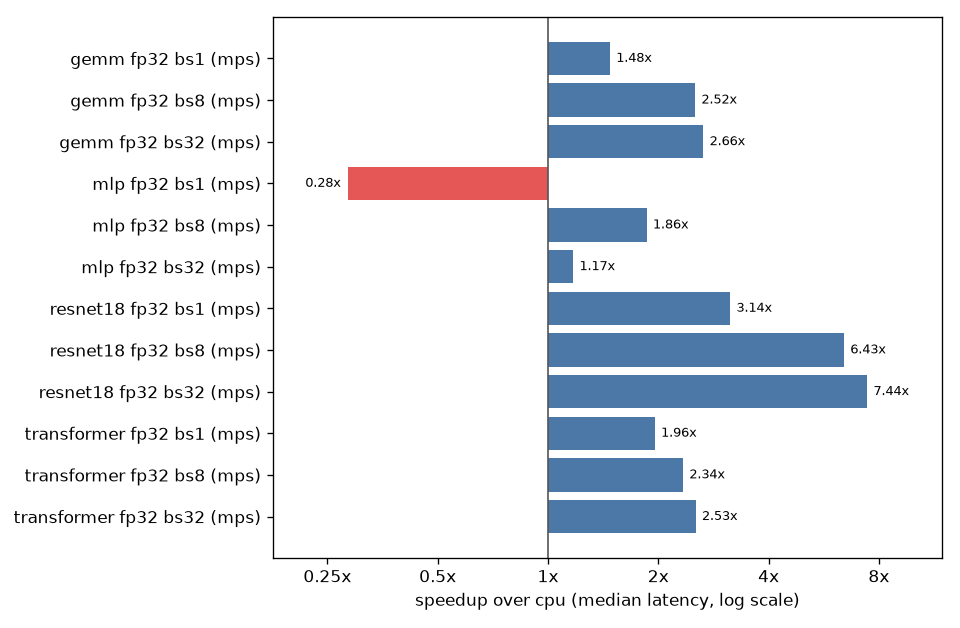

# perfgate

Automated PyTorch inference benchmarking: YAML-defined sweeps across workloads, devices,
precisions and batch sizes, each measurement in its own process with correct GPU
synchronization, plus a regression gate that uses repeat-level bootstrap confidence intervals
so that run-to-run noise doesn't get reported as a slowdown.

All results below were measured on an **Apple M4 (10-core CPU, 10-core GPU, 16 GB)**, macOS,
PyTorch 2.15, comparing the CPU with the Apple GPU through PyTorch's MPS backend. I don't
have access to an NVIDIA GPU. The CUDA code path exists but has **not** been run (see Limitations).

## Results

Every number here comes from a committed file in `results/`, produced by
`scripts/experiments.py`. Raw per-iteration samples are committed, so anything can be recomputed.

### 1. The regression gate vs. a fixed threshold (`results/gate_eval.json`)

6 cases (3 on the GPU, 3 on the CPU), each run as 10 separate baseline processes. The gate threshold
(`min_effect` = 3%) was set before the runs and not tuned afterwards.

**False alarms.** The 10 identical baseline processes for each case were split every possible way into
5 vs 5 and compared in both directions: 1,512 comparisons where the right answer is always
"no change".

| check | false alarms | rate |
|---|---:|---:|
| naive: pooled mean latency ≥ 3% slower | 47 / 1,512 | 3.1% |
| perfgate: 95% bootstrap CI over per-process medians excludes 1.0 **and** ≥ 3% slower | 4 / 1,512 | 0.26% |

All 51 false alarms came from one case, `mlp/cpu/fp32/bs32`, whose per-process median varied
by 6.2% (coefficient of variation). On that case the naive check flagged 47 of 252 identical
comparisons; the gate flagged 4.

**Detection.** Known slowdowns were injected by spinning for a fixed fraction of the baseline
median inside the timed region (after the device sync), 5 processes per level, compared
against the 10 baseline processes:

| injected slowdown | perfgate flagged | naive flagged |
|---|---:|---:|
| 2% (below the 3% threshold; should not flag) | 0 / 6 | 2 / 6 |
| 5% | 5 / 6 | 6 / 6 |
| 10% | 5 / 6 | 6 / 6 |
| 20% | 6 / 6 | 6 / 6 |

The gate's two misses at 5% and 10% are both the noisy `mlp/cpu/fp32/bs32` case, where the
95% CI for a 10% injected slowdown still ran from 0.89 to 1.21. With 6% process-to-process
noise and 5 repeats, the data can't separate a 10% slowdown from chance. The naive check "caught"
those but also flagged 19% of identical runs of the same case, so its alerts there carry no
information. The fix is more repeats for noisy cases, not a looser gate.

### 2. Unsynchronized GPU timing (`results/sync_pitfall.json`)

GPU work in PyTorch is queued asynchronously. If the timer stops without a
`torch.mps.synchronize()` (or `torch.cuda.synchronize()`), it measures the launch, not the work.
Same cases, 3 processes each, median latency per iteration:

| case | with sync | without sync | under-reported by |
|---|---:|---:|---:|
| gemm/mps/fp32/bs8 | 5.315 ms | 0.023 ms | 235x |
| transformer/mps/fp32/bs8 | 18.841 ms | 1.084 ms | 17x |
| mlp/mps/fp32/bs32 | 0.669 ms | 0.149 ms | 4.5x |
| resnet18/mps/fp16/bs8 | 11.863 ms | 11.395 ms | 1.04x |

The total loop time (which ends with one sync) stayed close in all four cases, so the work was
still being done; it just wasn't inside the timer. The ResNet-18 row is why this bug is easy
to miss: on that model the unsynchronized number happened to look right, presumably because
something in the MPS backend blocked on its own. I haven't confirmed why. A harness that "looks fine" on one model can be off by 235x on
another, so `perfgate` synchronizes inside every timed iteration and the test suite checks
that removing the sync breaks the measurement.

### 3. Sweep: CPU vs. Apple GPU (`results/sweep_m4.md`, `results/sweep_m4.jsonl`)

36 cases (4 workloads x {CPU fp32, GPU fp32, GPU fp16} x batch {1, 8, 32}), 5 processes each,
10 warm-up + 50 timed iterations per process.



- The GPU is not always faster. The 4-layer MLP at batch 1 ran in 0.163 ms on the CPU and
  0.573 ms on the GPU (0.28x). Per-kernel launch and synchronization overhead dominates work that small.
- The advantage grows with work per call: ResNet-18 went from 3.14x at batch 1 to 7.44x at batch 32.
- fp16 vs fp32 on the GPU: ResNet-18 batch 32 went from 56.66 ms to 44.11 ms (1.28x); the
  1024x1024 batched GEMM only from 20.28 ms to 18.72 ms (1.08x).
- Batched GEMM reached 3.39 TFLOPS (fp32) and 3.67 TFLOPS (fp16) on the GPU vs 1.28-1.49 on the CPU.
- The first call costs far more than steady state on the GPU (ResNet-18 fp32 batch 8: 118 ms
  first call vs 14.6 ms median), which is why warm-up iterations are excluded from timing.

## How it works

```
configs/*.yaml ──> config.parse ──> list of Cases (matrix minus excludes)
                                        │
runner.run_sweep ── for each repeat, for each case ──> subprocess: python -m perfgate.worker
                                        │                 build workload on device
                                        │                 warm up, then time N iterations,
                                        │                 synchronizing inside each one
                                        │                 print JSON: samples + environment fingerprint
                                        ▼
                               results/*.jsonl (one line per case x repeat)
                                        │
             report (Markdown table, speedup chart)   compare (gate; exit 1 on regression)
```

- **Workloads** (`workloads.py`): batched 1024x1024 GEMM, a 4-layer 1024-wide MLP,
  torchvision ResNet-18 (224x224), and a 6-layer transformer encoder (d=512, seq 128). Weights
  are random: timing doesn't depend on trained values, and no downloads are needed.
- **Worker** (`worker.py`): one fresh interpreter per (case, repeat). It records per-iteration
  latency, first-call latency, total loop time and an environment fingerprint (device name, OS,
  PyTorch version, thread count, git SHA).
- **Gate** (`stats.py`): each process contributes one number, its median latency. The gate
  bootstraps the ratio of the two sides' medians (2,000 resamples) and reports a regression only
  if the 95% CI is entirely above 1.0 *and* the point estimate is at least `min_effect` slower.
  It refuses to judge with fewer than 3 repeats a side, and warns when the two runs' fingerprints differ.
- **Slurm** (`slurm.py`): `perfgate slurm` writes a job-array script with one array task per case,
  `--exclusive` nodes, and optional Singularity/Apptainer wrapping. `perfgate merge` joins the shards.

## Setup and usage

Requires [uv](https://docs.astral.sh/uv/) and Python 3.12.

```bash
uv sync
uv run perfgate sweep configs/m4_sweep.yaml --out results/mine.jsonl
uv run perfgate report results/mine.jsonl --chart results/mine.png
uv run perfgate compare results/baseline.jsonl results/mine.jsonl   # exit 1 on regression
uv run perfgate slurm configs/m4_sweep.yaml --partition gpu --container perfgate.sif > sweep.sbatch
uv run python scripts/experiments.py all   # reproduce everything in Results (~30 min on the M4)
```

Docker (CPU image): `docker build -t perfgate . && docker run --rm perfgate sweep configs/ci_smoke.yaml --out /tmp/r.jsonl`

Sweep config:

```yaml
name: m4-sweep
repeats: 5
warmup: 10
iters: 50
matrix:
  workload: [gemm, mlp, resnet18, transformer]
  device: [cpu, mps]
  dtype: [fp32, fp16]
  batch: [1, 8, 32]
exclude:
  - {device: cpu, dtype: fp16}
```

## Design decisions

- **Processes, not iterations, are the unit of evidence.** Iterations in one process share caches,
  allocator state and clock history, so they're correlated. Pooling 250 of them as independent
  samples makes a small per-process wobble look significant. That is exactly what produced the
  naive check's 47 false alarms.
- **CI and a minimum effect size.** The CI alone would eventually flag real but irrelevant 0.5%
  shifts; the threshold alone flags noise. Requiring both is what gives a low false-alarm rate.
- **Interleaved repeats.** The runner does every case once, then every case again, rather than
  5 repeats back to back, so thermal drift or a background process spreads across cases instead
  of landing on one.
- **Errors are data.** An unsupported dtype, out-of-memory or timeout becomes an error record and
  the sweep continues; it doesn't lose a night's run.
- **CPU fp16 excluded from the sweep.** In a smoke test, ResNet-18 batch 1 in fp16 on the CPU took
  about 510 ms (vs about 9 ms in fp32), a slow fallback path that isn't a useful benchmark target.

## Limitations

- **No NVIDIA hardware.** The CUDA branches (`torch.cuda.synchronize`, device name, CUDA/cuDNN
  versions in the fingerprint) are written but have never run. Timing uses host
  `perf_counter` with a sync, not CUDA events.
- **No power measurement.** On macOS, GPU power is only available through `powermetrics` with
  root access, which I didn't use. An NVML-based power sampler for NVIDIA GPUs would be the next addition.
- **The Slurm script is generated and unit-tested, but has not been submitted to a real cluster.**
- **Injected slowdowns are synthetic** (a CPU spin after the sync). They test the gate's statistics,
  not whether it would catch a specific kind of real regression such as a slower kernel.
- **6 cases and one machine** for the gate evaluation. The false-alarm rate depends on how noisy
  a case is, so a noisier machine needs more repeats.
- **One unexplained result:** `mlp/cpu/fp32` ran faster at batch 32 (0.696 ms) than at batch 8
  (1.151 ms). It held across all 5 processes, but I haven't looked into which CPU kernel path causes it.
- The CPU baseline uses PyTorch's default thread count (10 on this machine), not a tuned setting.

## Testing

35 tests (`uv run pytest`):

- config matrix expansion and validation;
- the gate on synthetic data with known answers (identical runs, clean regressions, real but tiny
  shifts, and a single slow process that fools the naive check);
- the runner's interleaving, error and skip handling;
- CLI exit codes;
- Slurm script generation;
- real CPU measurements of every workload, including that an injected delay shows up in the samples;
- on Apple hardware, that timing the GPU without a sync under-reports latency by more than 10x (skipped elsewhere).

CI (GitHub Actions, CPU runners) runs ruff and the tests, then sweeps a small config twice,
compares the two runs, generates a Slurm script, and builds and runs the Docker image.

## Data & licensing

No external data: all inputs are random tensors and randomly initialized models defined in this
repo or in torchvision (BSD-3-Clause). Code is MIT licensed (see `LICENSE`).

## AI assistance disclosure

This project was written with AI assistance (Claude, by Anthropic). Commits carry a
`Co-Authored-By` trailer. Every number in this README comes from running the committed code on
the machine described above (`results/`).
